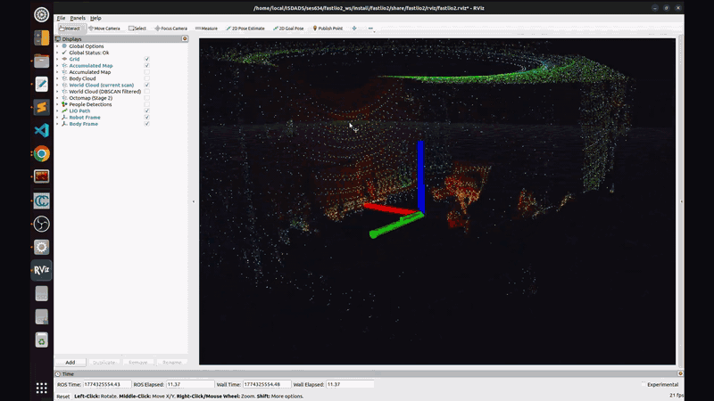

# FASTLIO2_ROS2 — Extended Mapping & Localization Suite

> **Based on [liangheming/FASTLIO2_ROS2](https://github.com/liangheming/FASTLIO2_ROS2)**
> — a ROS2 port of [Fast-LIO2](https://github.com/hku-mars/FAST_LIO) by Xu *et al.*

This fork extends the upstream project with a full localization pipeline, a real-time people
filter, semantic point-cloud labelling, and a GUI-based launch system, for indoor
LiDAR-inertial mapping and localization with a Livox MID360 sensor. It is research
code; see [Status and Testing](#status-and-testing) for what is checked automatically.

---

## Demo

<div align="center">
  <a href="https://youtu.be/Ip-UA0tPhvY">
    
  </a>
  <br>
  <sub>Highlights with the captions slowed down to read. Click to watch the full video on YouTube.</sub>
</div>
<br>

> *This demo showcases the system's core capabilities using the GUI Control Panel, including real-time point-cloud mapping, automatic global re-localization recovering from tracking failures (via global search), and the ability to seamlessly update and merge an existing map while exploring new areas.*

---

## Table of Contents

1. [Demo](#demo)
2. [What's New in This Fork](#whats-new-in-this-fork)
3. [System Architecture](#system-architecture)
4. [Package Overview](#package-overview)
5. [Prerequisites](#prerequisites)
6. [Installation](#installation)
7. [Usage](#usage)
   - [GUI Control Panel](#gui-control-panel)
   - [Mapping](#mapping)
   - [Localization](#localization)
   - [People Filter](#people-filter)
   - [Semantic Segmentation](#semantic-segmentation)
8. [ROS2 Topics & Services](#ros2-topics--services)
9. [Configuration Reference](#configuration-reference)
10. [Status and Testing](#status-and-testing)
11. [Credits](#credits)

---

## What's New in This Fork

The upstream [liangheming/FASTLIO2_ROS2](https://github.com/liangheming/FASTLIO2_ROS2) already provides
LiDAR-inertial odometry (`fastlio2`), global localization with NDT+ICP (`localizer`),
pose-graph optimization (`pgo`), hierarchical bundle adjustment (`hba`), and the service
interface definitions (`interface`).

This fork adds the following on top:

### Algorithmic Contributions

**Extended Localizer** (modifications to `localizer/`)

The upstream localizer supported manual ICP-only localization (pose hint required).
The following were added on top — the original manual-hint ICP mode is preserved as
`localizer_mode: icp`:

- **Global mode state machine** — a four-state FSM (IDLE → SEARCHING → TRACKING → LOST)
  that drives the full localization lifecycle without any user-provided pose hint.
- **Asynchronous global search** — the NDT+ICP grid search runs in a `std::async` thread
  with an odometry snapshot taken at launch time, so the map↔local offset is anchored
  to the correct moment even after a multi-second search.
- **Pose persistence with map-staleness detection** — the current map↔body transform is
  saved to YAML on disk at a configurable rate. On restart, `loadPose()` cross-checks the
  saved pose against the map file's modification time and silently discards it if the map
  has changed, falling back to a full global search.
- **ICP jump guard** — after each ICP alignment the result translation is compared against
  the odometry prediction; results exceeding `icp_max_jump_m` are rejected as wrong local
  minima rather than corrupting the offset.
- **Progressive ICP recovery** — at the half-failure threshold, correspondence distances
  are widened by `recovery_corr_scale` to give ICP a wider reach before a full global
  search is triggered. Distances are restored automatically once tracking recovers.
- **LIO dead-reckoning fallback** — if a global search fails *after* the robot previously
  had a good pose (i.e. entered unmapped territory), the node holds LIO dead-reckoning
  instead of entering an IDLE→SEARCH→FAIL spin that would corrupt the position estimate.
- **Degenerate scan guard** — scans below `min_cloud_points` are skipped entirely,
  preventing wasted ICP computation on empty or nearly-empty returns.
- **Hot-reload of merged map** — after `stop_mapping` saves a merged PCD, both the ICP
  and global localizers are reloaded on the service thread without a restart; ICP
  tracking continues against the new map.
- **Two-stage adaptive ICP** (`icp_localizer.cpp`) — rough and refine stages use separate
  voxel resolutions; if the rough fitness is marginal, the refine correspondence distance
  is automatically widened via `recovery_corr_scale` to avoid divergence from a
  slightly-off starting point.

**Multi-LiDAR Input** (modifications to `fastlio2/`)

The upstream LIO node accepted Livox `CustomMsg` only. This fork adds:

- **`lidar_type: 1`** — standard `sensor_msgs/PointCloud2` input (Velodyne, Ouster,
  Hesai, …) with datatype-checked field parsing. Per-point deskew time is decoded from
  whichever convention the driver uses: Velodyne `time` (float s), Ouster `t`
  (uint32 ns), or Hesai `timestamp` (double absolute s).
- **`acc_scale`** — configurable IMU acceleration multiplier (Livox IMUs report g;
  standard IMUs report m/s²), so non-Livox IMUs initialize correctly.
- Reference configs for a Boston Dynamics Spot + Velodyne VLP-16 setup
  (`fastlio2/config/lio_spot.yaml`, `localizer/config/localizer_spot.yaml`) and
  KISS-ICP-based IMU-free mapping launches for the same platform.

**Robustness & Concurrency Overhaul** (both C++ nodes)

- Both nodes run a **`MultiThreadedExecutor`** with heavy services (`save_map`,
  `relocalize`, `global_relocalize`, `stop_mapping`) in a dedicated callback group —
  a multi-second global search or compressed PCD write no longer stalls odometry or
  the `map → lidar` TF.
- All shared state is consistently locked; the non-thread-safe PCL NDT/ICP objects are
  serialized behind a single localizer mutex that the tracking timer only *try-locks*,
  so TF broadcasting continues from the last offset while a search or map reload runs.
- A **generation counter** invalidates an in-flight async search when a forced service
  relocalization supersedes it; the async search is exception-safe.
- **Fail-fast configuration** — missing/invalid YAML keys abort startup with a fatal
  log naming the exact key, instead of an unhandled exception.
- Empty-scan and degenerate-input guards, sensor-data QoS on IMU/LiDAR subscriptions,
  bounded trajectory history, and sim-time-aware clocks throughout the localizer.
- A **`/localizer/localizer_status`** heartbeat topic
  (`mode=… state=… dead_reckoning=… mapping=… searching=…`) for GUIs and monitoring.

**Adaptive DBSCAN People Filter** (`lidar_people_filter`)

A real-time human removal pipeline designed specifically for Livox MID360 point clouds
in indoor environments:

- **Range-adaptive ε** — DBSCAN neighbourhood radius scales with median scan range
  (1.2–1.5× multiplier beyond 3 m), compensating for the sensor's range-dependent
  point density so far-range humans cluster as reliably as close-range ones.
- **Voxel pre-downsampling** — normalises density before clustering so the geometry
  classifier sees consistent cluster shapes regardless of range or scan overlap.
- **Temporal consistency tracker** (`RepeatedHumanTracker`) — a sliding-window
  voxel-hit accumulator that tracks classified clusters over a configurable frame window
  (default 12 frames). A voxel that falls inside a human-shaped cluster in ≥ 70% of
  the window's frames is treated as a stationary person and removed, even in frames
  where the classifier misses it. Walls and furniture never look human-shaped, so they
  are never confirmed, and a voxel clears once the person leaves.
- **Multi-criterion geometry classifier** — height, footprint diameter, aspect ratio,
  point count, and an explicit single-axis width guard to prevent wall segments from
  being misclassified as humans.
- **Offline map cleaner** (`filter_map_pcd.py`) — applies the same classifier to a
  saved PCD file, with a spatial remapping step that recovers full-resolution points
  from the downsampled clustering result.

**RandLA-Net Semantic Segmentation** (`lidar_semantic`)

Integration of RandLA-Net (CVPR 2020) for per-scan SemanticKITTI labelling:

- Decoupled inference via a background worker thread — the ROS subscriber only
  updates a pending-message slot; the worker drains it asynchronously, keeping
  the ROS graph responsive under GPU load.
- Multi-scale KNN graph and random downsampling indices are precomputed in NumPy
  before each forward pass, avoiding redundant GPU↔CPU transfers.
- Class-conditional output streams: person cloud, ground cloud, and a full labelled
  cloud are published separately for downstream consumption.

### Infrastructure Contributions

| Addition | Description |
|----------|-------------|
| **Launch Orchestration** | Modular launch files covering every combination of live/rosbag, mapping/localization, with/without people filter and RViz |
| **PyQt5 GUI** | Dark-themed control panel for launching stacks, toggling the Livox driver, triggering services, and monitoring output — no terminal required |

---

## System Architecture

```
┌──────────────────────────────────────────┐
│         Livox MID360 Driver              │
│   livox_ros_driver2_node  @10 Hz         │
└───────────────┬──────────────────────────┘
                │ /livox/lidar  /livox/imu
                ▼
┌──────────────────────────────────────────┐
│          FASTLIO2  LIO Node  (C++)        │
│  IESKF  ·  ikd-Tree  ·  IMU Integrator  │
│                                          │
│  /fastlio2/body_cloud   (body frame)     │
│  /fastlio2/world_cloud  (world frame)    │
│  /fastlio2/lio_odom                      │
│  /fastlio2/accumulated_map               │
└──────┬────────────────┬──────────────────┘
       │                │
       │         ┌──────▼──────────────────┐
       │         │  DBSCAN People Filter   │
       │         │  (optional, live)       │
       │         │  /fastlio2/body_cloud   │
       │         │    → body_cloud_filtered│
       │         └──────┬──────────────────┘
       │                │
  MAPPING           LOCALIZATION
  MODE                  │
       │          ┌─────▼──────────────────┐
       │          │   ICP Localizer (C++)  │
       │          │   NDT global search    │
       │          │   → continuous ICP     │
       │          │   → TF: map→lidar      │
       │          └────────────────────────┘
       │
  /fastlio2/save_map ──▶ map.pcd
                                ┌──────────────────────────┐
  /fastlio2/body_cloud ────────▶│  RandLA-Net  (optional)  │
                                │  SemanticKITTI · 19 cls  │
                                │  /semantic/person_cloud  │
                                │  /semantic/ground_cloud  │
                                └──────────────────────────┘
```

**TF tree**

```
map
 └── lidar   (LIO world frame — map→lidar published by the localizer)
      └── body    (published by the LIO node)
```

Frame names come from the configs (`world_frame`/`body_frame` in `lio.yaml`,
`map_frame`/`local_frame` in `localizer.yaml`).

---

## Package Overview

### Core (from upstream, extended in this fork)

| Package | Language | Role |
|---------|----------|------|
| `fastlio2` | C++ | LiDAR-inertial odometry — IESKF + ikd-Tree SLAM core (+ PointCloud2 input, robustness fixes) |
| `localizer` | C++ | Global localization (NDT+ICP) + continuous ICP tracking against a PCD map (+ global mode, map update, concurrency fixes) |
| `interface` | CMake | ROS2 service/message definitions (+ GlobalRelocalize, StartMapping, StopMapping) |
| `pgo` | C++ | Pose-graph optimization (unchanged) |
| `hba` | C++ | Hierarchical bundle adjustment for map refinement (build fix only) |

### Added in This Fork

| Package | Language | Role |
|---------|----------|------|
| `fastlio2_bringup` | Python | Launch files + PyQt5 GUI control panel |
| `lidar_people_filter` | Python | Real-time DBSCAN people removal + offline PCD cleaner |
| `lidar_semantic` | Python/PyTorch | RandLA-Net semantic segmentation of incoming scans |

---

## Prerequisites

- **ROS2** Humble or later
- **C++ libraries** — PCL, Eigen3, Sophus, yaml-cpp (all resolvable via `rosdep`);
  **GTSAM** for the `pgo` and `hba` packages (`sudo apt install libgtsam-dev
  libgtsam-unstable-dev` on Ubuntu 22.04; CI uses these)
- **Livox ROS Driver 2** — built in a separate workspace (e.g. `~/livox_ws`)
- **Python ≥ 3.8** with `PyQt5`, `numpy`, `open3d`, `scikit-learn`
- **PyTorch ≥ 1.12** with CUDA (for `lidar_semantic` — CPU fallback available)
- A **Livox MID360** or compatible sensor (for live data mode); Velodyne/standard
  PointCloud2 sensors supported via `lidar_type: 1`

```bash
pip install PyQt5 numpy open3d scikit-learn torch torchvision
```

---

## Installation

```bash
# 1. Source Livox driver workspace
source ~/livox_ws/install/setup.bash

# 2. Clone this repo into your ROS2 workspace
cd ~/ros2_ws/src
git clone https://github.com/knnurl/FASTLIO2_ROS2.git

# 3. Resolve system dependencies (PCL, Eigen, Sophus, yaml-cpp, ...)
cd ~/ros2_ws
rosdep install --from-paths src --ignore-src -r -y

# 4. Build
colcon build --symlink-install --packages-select \
    interface fastlio2 localizer fastlio2_bringup lidar_people_filter lidar_semantic
# (add pgo hba if you have GTSAM installed)

# 5. Source the workspace
source install/setup.bash
```

### Download semantic weights (optional)

```bash
cd src/FASTLIO2_ROS2/lidar_semantic
python3 scripts/download_weights.py
```

---

## Usage

### GUI Control Panel

The easiest way to operate the full system:

```bash
ros2 run fastlio2_bringup fastlio2_gui.py
```

The panel lets you:

- Switch between **Mapping** and **Localization** modes
- Toggle **Live data** to launch the Livox driver, or leave it unchecked to replay a rosbag
- Browse to a `.pcd` map file
- Start / stop the stack and monitor live log output
- Call services (Save Map, Force Re-Localize, Check Status) with one click

### Mapping

**With live sensor (GUI or terminal):**

```bash
ros2 launch fastlio2_bringup mapping_full.launch.py
```

**Rosbag replay (driver-less):**

```bash
ros2 launch fastlio2_bringup mapping.launch.py
# In another terminal:
ros2 bag play <your_bag>
```

**Save the map once mapping is complete:**

```bash
ros2 service call /fastlio2/save_map interface/srv/SaveMaps \
    "{file_path: '$HOME/maps/map.pcd', save_patches: false}"
```

**Optional — remove people from the saved map:**

```bash
python3 src/lidar_people_filter/scripts/filter_map_pcd.py \
    ~/maps/map.pcd --output ~/maps/map_clean.pcd
```

### Localization

**With live sensor:**

```bash
ros2 launch fastlio2_bringup localization_full.launch.py \
    map_path:=$HOME/maps/map_clean.pcd
```

Key arguments:

| Argument | Default | Description |
|----------|---------|-------------|
| `map_path` | `~/fastlio2_ws/maps/map.pcd` | Path to pre-saved PCD map |
| `use_people_filter` | `true` | Enable real-time DBSCAN filter |
| `force_global_search` | `true` | Ignore saved pose; always run full NDT+ICP search |
| `launch_rviz` | `true` | Start RViz2 (set `false` when using the GUI) |

**Rosbag replay:**

```bash
ros2 launch fastlio2_bringup localization.launch.py \
    map_path:=$HOME/maps/map_clean.pcd
```

**Trigger manual re-localization at any time** (e.g. after the robot has been moved):

```bash
ros2 service call /localizer/global_relocalize interface/srv/GlobalRelocalize \
    "{pcd_path: '', force: true}"
```

### People Filter

Launched automatically by `localization_full.launch.py` when `use_people_filter:=true`.
To run it standalone (e.g., alongside a custom stack):

```bash
ros2 launch lidar_people_filter people_filter.launch.py
```

The filter subscribes to `/fastlio2/body_cloud` and publishes the cleaned cloud on
`/fastlio2/body_cloud_filtered`.  Tune `config/dbscan_filter.yaml` to match your
environment's crowd density and scan characteristics.

### Semantic Segmentation

```bash
ros2 launch lidar_semantic semantic.launch.py \
    input_topic:=/fastlio2/body_cloud_filtered \
    device:=cuda
```

Published topics:

| Topic | Content |
|-------|---------|
| `/semantic/labelled_cloud` | Full scan — intensity = class index, RGB packed as float32 |
| `/semantic/person_cloud` | Person + bicyclist + motorcyclist points only |
| `/semantic/ground_cloud` | Road + parking + sidewalk + terrain points |
| `/semantic/markers` | RViz sphere markers, one per detected cluster |

---

## ROS2 Topics & Services

### Topics

| Topic | Type | Publisher | Description |
|-------|------|-----------|-------------|
| `/fastlio2/body_cloud` | `sensor_msgs/PointCloud2` | fastlio2 | Current scan in body (LiDAR) frame |
| `/fastlio2/world_cloud` | `sensor_msgs/PointCloud2` | fastlio2 | Current scan in world frame |
| `/fastlio2/lio_odom` | `nav_msgs/Odometry` | fastlio2 | LIO odometry at scan rate |
| `/fastlio2/lio_path` | `nav_msgs/Path` | fastlio2 | Full trajectory history |
| `/fastlio2/accumulated_map` | `sensor_msgs/PointCloud2` | fastlio2 | Periodically downsampled map cloud |
| `/fastlio2/body_cloud_filtered` | `sensor_msgs/PointCloud2` | people_filter | People-removed body cloud |
| `/localizer/map_cloud` | `sensor_msgs/PointCloud2` | localizer | Pre-saved map (for RViz) |
| `/localizer/mapping_cloud` | `sensor_msgs/PointCloud2` | localizer | Newly accumulated cloud during map update (map frame) |
| `/localizer/localizer_status` | `std_msgs/String` | localizer | 1 Hz heartbeat: `mode=… state=… dead_reckoning=… mapping=… searching=…` |

### Services

| Service | Interface | Description |
|---------|-----------|-------------|
| `/fastlio2/save_map` | `interface/srv/SaveMaps` | Write current ikd-tree map to a PCD file |
| `/localizer/global_relocalize` | `interface/srv/GlobalRelocalize` | Trigger NDT+ICP global search; returns pose + fitness score |
| `/localizer/relocalize` | `interface/srv/Relocalize` | Manual relocalization with an explicit pose hint (ICP mode) |
| `/localizer/relocalize_check` | `interface/srv/IsValid` | Query whether the localizer is tracking confidently |
| `/localizer/start_mapping` | `interface/srv/StartMapping` | Begin auxiliary map update |
| `/localizer/stop_mapping` | `interface/srv/StopMapping` | End map update, merge with the loaded map, save, and hot-reload |

---

## Configuration Reference

### `fastlio2/config/lio.yaml`

Core LIO parameters: topics and frames, scan/map voxel resolutions
(`scan_resolution`, `map_resolution`), range gating (`lidar_min_range`,
`lidar_max_range`, `lidar_filter_num`), ikd-tree bounds (`cube_len`, `det_range`),
IMU noise (`na`/`ng`/`nba`/`nbg`) and extrinsics (`r_il`/`t_il`). Sensor selection:
`lidar_type` (0 = Livox CustomMsg, 1 = PointCloud2) and `acc_scale` (10.0 for
Livox g-units, 1.0 for standard m/s² IMUs). See `lio_spot.yaml` for a
Velodyne/Spot reference.

### `localizer/config/localizer.yaml`

Localizer mode (`localizer_mode: global` or `icp`), map path, ICP tracking
thresholds (rough/refine resolutions, iterations, fitness cutoffs), global search
grid (`global_xy_step_m`, `global_yaw_step_deg`, NDT resolution, top-K), recovery
behaviour (`lost_patience_sec`, `icp_recovery_corr_scale`, `icp_max_jump_m`) and
pose persistence (`pose_save_path`, `pose_save_hz`). See `localizer_spot.yaml`
for the Velodyne/Spot variant. The file is extensively commented.

### `lidar_people_filter/config/dbscan_filter.yaml`

```yaml
# DBSCAN clustering
voxel_size: 0.10        # pre-downsample resolution (m)
eps: 0.40               # neighbourhood radius
min_samples: 3          # minimum points per cluster

# Geometry-based human classifier
human_min_height: 0.8   # m — minimum cluster height
human_max_height: 2.2   # m — maximum cluster height
human_min_footprint: 0.1
human_max_footprint: 1.0
aspect_ratio_min: 1.2   # height/width — rejects flat objects

# Temporal consistency
temporal_window: 12     # frames to track voxel history
static_threshold: 0.70  # fraction of frames → static, keep
```

### `lidar_semantic/config/semantic.yaml`

Model path, inference device (`cuda` / `cpu`), number of points per inference (16 384),
and per-class confidence threshold.

---

## Status and Testing

[](https://github.com/knnurl/FASTLIO2_ROS2/actions/workflows/build.yml)

The stack has been run on a Livox MID360 indoors and on a Boston Dynamics Spot with a
Velodyne VLP-16. CI builds every package on ROS 2 Humble (Ubuntu 22.04) and runs the
unit tests:

| Test | Covers |
|------|--------|
| `fastlio2/test/test_pc2_to_pcl.cpp` | PointCloud2 parsing: Velodyne, Ouster and Hesai time fields, intensity types, range and NaN filtering |
| `localizer/test/test_localizer_fsm.cpp` | Localizer recovery: ICP failure patience, widening, global search vs. dead reckoning |
| `lidar_people_filter/test/test_classifier.py` | People filter: human-cluster classifier with the shipped config, stationary-person tracker |

Run them locally:

```bash
colcon test --packages-select fastlio2 localizer lidar_people_filter --ctest-args -LE linter
colcon test-result --verbose
```

The packages keep upstream's ament linters enabled, and the code does not pass them
yet, so `colcon test` without `-LE linter` also reports lint failures.

The `experimental/health-prototype` branch holds an untested prototype of a closed-loop
map-health layer from April 2026; its `docs/health-prototype/STATUS.md` lists the known
problems.

---

## Credits

- **FAST-LIO2** — Xu *et al.*, HKU-MARS Lab.
  [Paper](https://arxiv.org/abs/2107.06829) · [Code](https://github.com/hku-mars/FAST_LIO)
- **FASTLIO2_ROS2** — ROS2 port by
  [liangheming](https://github.com/liangheming/FASTLIO2_ROS2)
- **RandLA-Net** — Hu *et al.*, CVPR 2020.
  [Paper](https://arxiv.org/abs/1911.11236) · pretrained weights from
  [tsunghan-parent/randlanet-pytorch](https://github.com/tsunghan-parent/randlanet-pytorch)
- **Livox ROS Driver 2** — [Livox-SDK/livox_ros_driver2](https://github.com/Livox-SDK/livox_ros_driver2)
